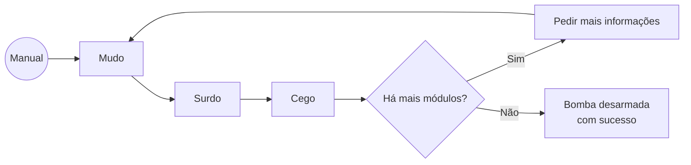

# Estratégia

Para vencer o jogo é necessário desarmar a bomba com sucesso.
Para isso, é necessário completar todos os módulos que a bomba tem.
As instruções para concluir os módulos estão no manual.
O macaco mudo vê o manual e transmite as suas informações para o surdo.
O surdo transmite essas mesmas informações para o cego, no qual irá usá-las para desarmar a bomba.
Se a bomba tiver mais de um módulo, o cego tem de pedir mais informações para conseguir completar todos. Pede essas informações ao mudo, que volta a passá-las ao surdo e novamente ao cego.
Caso já tenha finalizado a totalidade dos módulos, a bomba é desarmada.

O seguinte fluxograma mostra a ordem de como transmitir informações de maneira correta para desarmar a bomba.

